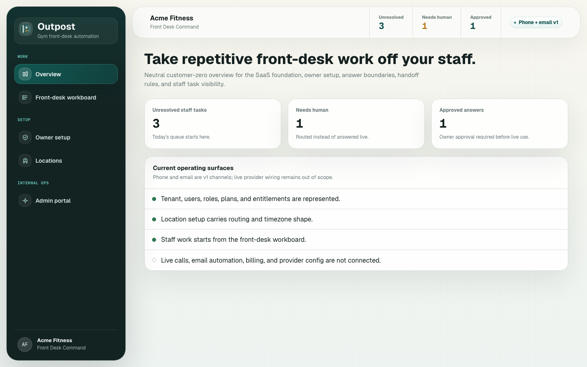
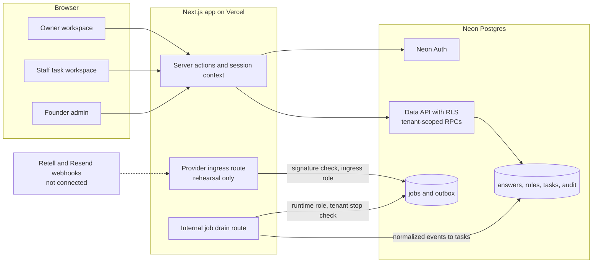

# Outpost

Outpost is multi-tenant SaaS that takes repetitive phone and email work off a gym's front desk.



## The problem

Gym front-desk staff greet members, take calls, and answer email, and they're still expected to sell memberships and run tours. Many of those interruptions are routine questions about hours and policies. Software can take those off the desk only if it stays inside what the owner has approved and never touches a member's account.

## What I built

These pieces run in code today:

- **Owner-approved answer bank.** Owners enter source facts per location. Outpost stages them as draft answers, or as conflicts when two sources disagree. Only an owner's approval marks an answer safe to use live, and each edit writes a revision and an audit row.
- **Handoff rules.** Owners decide when a human takes over: always-human topics, missing facts, conflicts, low confidence, or an explicit request. Each rule creates a task, notifies staff, or blocks automation.
- **Staff task workspace.** Staff land on a queue sorted Needs human, New, In progress, Done, Ignored. They can assign, add notes, search, and filter, and on a phone each row becomes a stacked card. Tasks carry a provenance label that shows where they came from.
- **Owner setup workspace.** One page holds location profiles, notification destinations, the staff roster with account claim, a burden report, and a stop switch that pauses that tenant's background processing.
- **Admin and readiness tooling.** A founder-admin console tracks beta access requests, fulfillment preflight, receipts, and proof runs. Fulfillment changes data, so it runs from the CLI only.
- **Tenant isolation in Postgres.** 57 checksummed Atlas migrations on Neon, row-level security on tenant tables, and separate least-privilege roles for the job runner, provider ingress, and the policy compiler. CI applies the full migration history to a fresh Postgres and runs SQL authority and concurrency checks.
- **Provider ingress, offline.** Webhook signature checks for Retell (voice) and Resend (email) run over the raw body before parsing. A jobs/outbox queue feeds normalizers that turn provider events into tasks. The route only exists as a locked rehearsal seam on a protected Preview.
- **Policy review.** Owner setup compiles into an immutable policy snapshot. The owner can accept or reject it, and acceptance counts as review evidence only. It doesn't let anything run.

I haven't built live calls or inbound email on those adapters yet. Importing facts from a gym's website and Google profile is also still planned, along with voice-minute usage metering and Instagram/Facebook inbox routing.

## Architecture



## Product decisions

### Owner-approved answers only

Setup can gather facts broadly, but at runtime Outpost may answer only from what the owner approved. When a fact is missing, conflicting, or unapproved, the reply is that staff will follow up, and a task opens. I treat a task staff can act on as the proof the product works, so there's no chat window in the product.

### Burden metrics count only what the data proves

The owner report shows tasks created and resolved, answer review progress, and open work by channel and request type. It leaves out calls handled, time saved, and anything that looks like billing until real provider and customer evidence exists, because showing those numbers early would overclaim.

### One design partner, built for the next gym

A single gym is customer zero, and no v1 decision is allowed to be specific to it. Once the launch-readiness tooling had made faked proof hard, I froze it. More control layers were adding process cost without making the product more ready, so the freeze lifts only when a real session with that gym is on the calendar.

## Status

Pre-live. The owner-to-staff workflow has passed end to end on a protected Vercel Preview backed by a Neon branch. Live phone, email, and invites stay off, and the next gate is a working session with the design partner.

## About

Built by Krish Puvvada, AI product leader. More at [krishpuvvada.com](https://krishpuvvada.com).

I'm Krish Puvvada, an AI product leader. I built Outpost on my own time with Claude Code as my pair. This repo is a single-commit public snapshot of a private working repo. Customer and gym names (Acme Fitness, Summit Strength, Peak CrossFit) are fictional, and internal planning docs are left out.


## Run it

Requires Node 22.

```bash
npm ci
npm test        # 820 tests across 80 files (Vitest)
npm run check   # TypeScript, then the test suite
npm run build
npm run dev     # http://localhost:3000
```

The overview page renders from seed data. Owner and staff routes sign in through Neon Auth, so they need a Neon project: copy `.env.example` and follow [docs/setup/neon-migration-spike.md](docs/setup/neon-migration-spike.md). Migration commands need the [Atlas CLI](https://atlasgo.io), for example `npm run db:migrations:validate`.

## Stack

- Next.js 16 (App Router), React 19, TypeScript
- Neon Postgres, Neon Auth, Neon Data API
- Atlas for checksummed migrations (`neon/migrations/`)
- Vitest and Testing Library, with GitHub Actions running the test suite and the Postgres contract checks
- Retell (voice) and Resend (email) adapters, offline only
- Vercel for Preview deployments

## Where the docs live

- [DESIGN.md](DESIGN.md): design system and product surfaces
- [docs/brainstorms/](docs/brainstorms/): product thesis and per-feature decisions, starting with [the product thesis](docs/brainstorms/2026-06-08-outpost-product-thesis-brainstorm.md)
- [docs/solutions/](docs/solutions/): reusable architecture and integration patterns
- [docs/setup/](docs/setup/) and [docs/runbooks/](docs/runbooks/): environment setup, migrations, test gates, security headers
- [CONCEPTS.md](CONCEPTS.md): domain vocabulary
